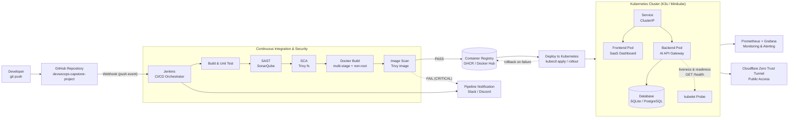
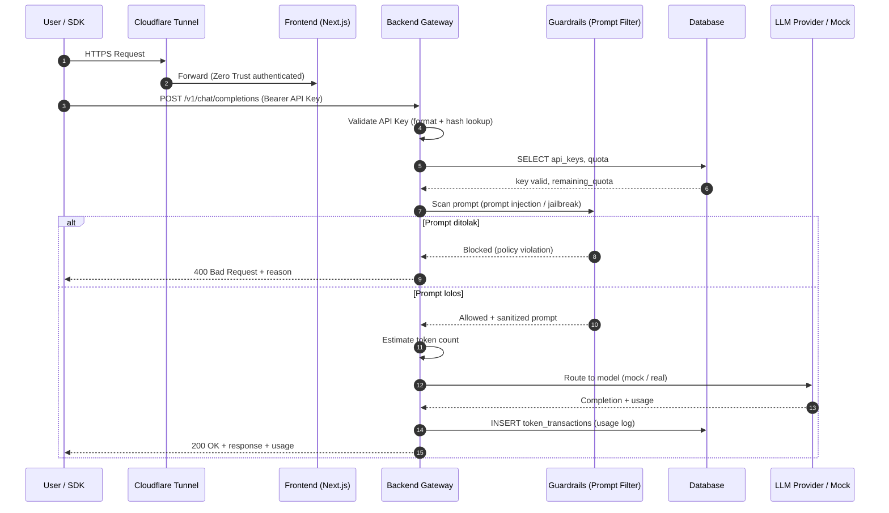
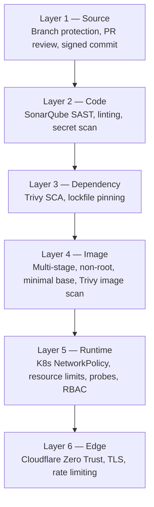
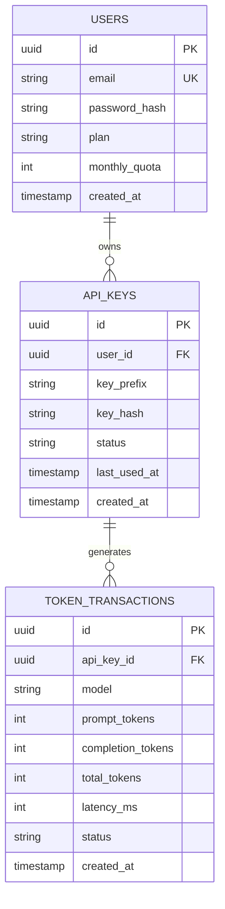

# DevSecOps Capstone Project — Automated CI/CD Pipeline for a Full-Stack SaaS AI API Gateway

<p align="left">
  
  
  
  
  
  
</p>

> **Internship Capstone Project** — Repository ini adalah *logbook* progres dan laporan teknis
> implementasi **Automated DevSecOps CI/CD Pipeline** dengan studi kasus aplikasi
> **Full-Stack SaaS AI API Gateway**.

---

## Daftar Isi

1. [Ringkasan Eksekutif](#1-ringkasan-eksekutif)
2. [Tujuan Projek](#2-tujuan-projek)
3. [Topologi & Pilar DevSecOps](#3-topologi--pilar-devsecops)
4. [Diagram Arsitektur](#4-diagram-arsitektur)
5. [Spesifikasi Aplikasi Target](#5-spesifikasi-aplikasi-target)
6. [Struktur Direktori](#6-struktur-direktori)
7. [Roadmap Eksekusi (4 Fase)](#7-roadmap-eksekusi-4-fase)
8. [Progress Checklist](#8-progress-checklist)
9. [Tech Stack](#9-tech-stack)
10. [Cara Menjalankan (Preview Fase 2+)](#10-cara-menjalankan-preview-fase-2)
11. [Dokumentasi Terkait](#11-dokumentasi-terkait)
12. [Kontak](#12-kontak)

---

## 1. Ringkasan Eksekutif

Projek ini mendemonstrasikan bagaimana sebuah aplikasi **SaaS AI API Gateway** dapat dibangun
dan dikirim (*delivered*) melalui pipeline **CI/CD otomatis yang aman sejak awal (shift-left security)**.
Setiap `git push` ke branch `main` akan memicu Jenkins melalui **GitHub Webhook**, menjalankan
serangkaian tahapan build, pengujian, pemindaian keamanan, pembuatan image container, hingga
deployment ke cluster Kubernetes — tanpa intervensi manual.

Fokus penilaian bukan hanya pada aplikasi yang berjalan, tetapi pada **kualitas rekayasa pipeline**:
bagaimana kode diverifikasi, bagaimana kerentanan dideteksi sebelum rilis, dan bagaimana sistem
dapat dipulihkan (*rollback*) secara terkontrol.

| Aspek | Keterangan |
| :--- | :--- |
| **Nama Projek** | Automated DevSecOps CI/CD Pipeline — SaaS AI API Gateway |
| **Jenis** | Internship Capstone Project |
| **Repositori** | [`0xshalah/devsecops-capstone-project`](https://github.com/0xshalah/devsecops-capstone-project) |
| **Branch Utama** | `main` |
| **Status Saat Ini** | **Fase 1 — Inisialisasi dokumentasi arsitektur & struktur folder** |
| **Model Kerja** | 4 fase berurutan (*phased delivery*) |

---

## 2. Tujuan Projek

1. **Membangun pipeline DevSecOps end-to-end** yang terotomasi dari commit hingga runtime.
2. **Menerapkan shift-left security**: SAST dan SCA dijalankan pada setiap build, bukan setelah rilis.
3. **Menyediakan studi kasus nyata** berupa aplikasi Full-Stack SaaS AI API Gateway yang cukup
   kompleks untuk menguji pipeline (multi-service, container, health probe, database).
4. **Menghasilkan artefak yang dapat diaudit**: laporan SonarQube, laporan Trivy, riwayat build
   Jenkins, dan manifest Kubernetes yang ter-versi.
5. **Menjadi logbook teknis** yang mendokumentasikan keputusan arsitektur dan progres magang.

### Prinsip yang Dipegang

- **Security as Code** — aturan keamanan hidup di repository, bukan di kepala engineer.
- **Immutable Artifact** — image yang lolos scan adalah image yang di-deploy; tidak ada rebuild di runtime.
- **Fail Fast, Fail Safe** — pipeline berhenti pada temuan `CRITICAL`; deployment tidak pernah
  menimpa versi sehat tanpa strategi rollback.
- **Least Privilege** — container berjalan sebagai non-root, secret tidak masuk ke image.

---

## 3. Topologi & Pilar DevSecOps

### 3.1 Source Control & Trigger

- **GitHub Repository**: `devsecops-capstone-project` (branch `main` sebagai *protected branch*).
- **Webhook**: GitHub mengirim event `push` ke endpoint Jenkins (`/github-webhook/`) secara otomatis
  setiap ada commit baru — tidak ada polling.
- **Branching**: `main` untuk rilis, `feature/*` untuk pengembangan; Pull Request memicu build
  verifikasi sebelum merge.

### 3.2 CI/CD Engine

- **Jenkins** sebagai orkestrator tunggal pipeline.
- Pipeline didefinisikan sebagai **Jenkinsfile** (declarative pipeline) yang tersimpan di repository
  sehingga dapat di-review seperti kode.
- Tahapan: `Checkout → Build → Unit Test → SAST → SCA → Docker Build → Image Scan → Push Registry → Deploy → Verify`.

### 3.3 Security Scanning (DevSecOps)

| Jenis | Tool | Target | Gate |
| :--- | :--- | :--- | :--- |
| **SAST** | SonarQube | Source code (frontend & backend) | *Quality Gate* harus `Passed` |
| **SCA** | Trivy (`fs`) | Dependency & lockfile | Gagal jika ada `CRITICAL` |
| **Container Image Scan** | Trivy (`image`) | Layer Docker image sebelum push | Gagal jika ada `CRITICAL` dengan fix tersedia |
| **Secret Scan** *(opsional)* | Gitleaks | Riwayat commit | Gagal jika secret terdeteksi |

### 3.4 Containerization & Registry

- **Docker multi-stage build** untuk memperkecil ukuran image dan menghilangkan toolchain build.
- **Non-root user** (`USER appuser`, UID 10001) pada image runtime.
- **Read-only root filesystem** dan `no-new-privileges` bila didukung runtime.
- **Registry**: Docker Hub / GitHub Container Registry (GHCR), dengan tagging immutable
  `:<git-sha>` dan mutable `:latest` hanya untuk lingkungan non-produksi.

### 3.5 Runtime Deployment

- **Kubernetes ringan**: K3s (produksi lokal) atau Minikube (pengembangan).
- **Liveness Probe** → `GET /health` memastikan proses hidup; jika gagal, pod di-restart.
- **Readiness Probe** → `GET /health` (atau `/ready`) memastikan pod siap menerima trafik;
  jika gagal, pod dikeluarkan dari Service endpoint.
- **Resource requests/limits** dan **Horizontal Pod Autoscaler** (fase lanjutan).
- **RollingUpdate** dengan `maxUnavailable: 0` untuk zero-downtime deployment.

### 3.6 Komponen Tambahan (Fase Lanjutan)

- **Prometheus + Grafana** — metrik pipeline, aplikasi (latency, error rate, token usage), dan cluster.
- **Cloudflare Zero Trust Tunnel** — ekspos aplikasi ke publik tanpa membuka port inbound,
  tanpa IP publik, dengan autentikasi di edge.
- **Notifikasi status pipeline** — Slack/Discord/Telegram webhook untuk hasil build & deployment.

---

## 4. Diagram Arsitektur

### 4.1 Alur End-to-End Pipeline



### 4.2 Alur Request Runtime (AI Gateway)



### 4.3 Lapisan Keamanan (Defense in Depth)



---

## 5. Spesifikasi Aplikasi Target

### 5.1 Frontend — SaaS Landing Page & Dashboard

| Fitur | Deskripsi |
| :--- | :--- |
| **Landing Page** | Halaman produk SaaS modern: hero section, value proposition, daftar fitur, tabel harga (Free / Pro / Enterprise), CTA. |
| **Authentication UI** | Halaman login/register, sesi pengguna, proteksi route dashboard. |
| **API Key Management** | Buat, lihat (masked), rotasi, dan revoke API Key. Key hanya ditampilkan sekali saat dibuat. |
| **Live Playground** | Antarmuka uji prompt interaktif: pilih model, atur temperature/max tokens, kirim prompt, tampilkan respons streaming. |
| **Usage Dashboard** | Grafik pemakaian token harian/bulanan, sisa kuota, estimasi biaya, riwayat request terakhir. |

**Rencana stack**: Next.js (App Router) + TypeScript + Tailwind CSS, di-serve sebagai static/standalone
build dan dikemas dalam container non-root (port 3000).

### 5.2 Backend Core — AI API Gateway Engine

| Komponen | Tanggung Jawab |
| :--- | :--- |
| **Reverse Proxy & Router** | Meneruskan request ke model AI/LLM yang dipilih; mendukung beberapa provider dan fallback. |
| **`GET /health`** | Endpoint ringan untuk **liveness** & **readiness** probe Kubernetes (tanpa dependency eksternal berat). |
| **`GET /ready`** *(opsional)* | Memeriksa koneksi database sebelum menyatakan pod siap menerima trafik. |
| **API Key Validation** | Verifikasi format, hash lookup, status aktif/revoked, dan kuota tersisa. |
| **AI Security / Guardrails** | Filter **prompt injection**, deteksi jailbreak, blokir pola berbahaya, pembatasan panjang input. |
| **Token Estimator** | Estimasi jumlah token sebelum request (pre-flight) dan pencatatan usage aktual pasca-request. |
| **LLM Routing** | Mode **mock** (deterministik, untuk CI/test tanpa biaya) dan mode **real** (provider API via env var). |
| **Rate Limiting** | Pembatasan request per API Key / per IP untuk mencegah penyalahgunaan. |

**Rencana stack**: Node.js (Fastify/Express) + TypeScript, atau Python (FastAPI). Keputusan final
dicatat sebagai ADR pada Fase 2. Container berjalan sebagai `appuser` (UID 10001), port 8080.

### 5.3 Database Layer

- **Fase 2 (MVP)**: SQLite (file-based, zero-config) untuk mempercepat iterasi dan memudahkan CI.
- **Fase 4+**: Migrasi ke PostgreSQL (StatefulSet/Deployment + PVC) bila diperlukan konkurensi tulis.
- **Skema inti**:



**Prinsip penyimpanan secret**: API Key **tidak pernah** disimpan dalam bentuk plaintext —
hanya `key_hash` (SHA-256 + salt) dan `key_prefix` untuk keperluan tampilan.

---

## 6. Struktur Direktori

```text
devsecops-capstone-project/
├── README.md                  # Logbook progres, ringkasan projek, roadmap
├── ARCHITECTURE.md            # Desain sistem & standar keamanan (dokumen ini)
├── .gitignore
├── .dockerignore
├── frontend/                  # SaaS landing page & dashboard (Fase 2)
├── backend/                   # AI API Gateway engine (Fase 2)
├── database/                  # Skema, migrasi, seed data (Fase 2)
├── docker/                    # Dockerfile & docker-compose untuk local dev (Fase 2)
├── jenkins/                   # Jenkinsfile & konfigurasi pipeline (Fase 3)
├── k8s/                       # Manifest Kubernetes: deployment, service, ingress (Fase 4)
├── monitoring/                # Konfigurasi Prometheus, Grafana, alert rules (Fase lanjutan)
├── scripts/                   # Skrip bantu: build, scan, deploy, smoke test
└── docs/                      # Diagram, laporan scan, ADR, screenshot
    └── assets/                # Gambar & artefak dokumentasi
```

> Direktori saat ini hanya berisi `.gitkeep` sebagai *placeholder*. Kode aplikasi dan pipeline
> **sengaja belum dibuat** — sesuai roadmap, implementasi dimulai pada Fase 2 setelah dokumen
> arsitektur ini disetujui dan ter-push.

---

## 7. Roadmap Eksekusi (4 Fase)

Pengerjaan dibagi menjadi **4 fase berurutan** agar sistem tetap stabil, mudah diuji, dan setiap
tahap menghasilkan artefak yang dapat diverifikasi.

### Fase 1 — Inisialisasi Dokumentasi & Struktur Repo  ·  *(Target saat ini)*

- [x] Inisialisasi repository `devsecops-capstone-project` dan remote GitHub.
- [x] Menyusun `README.md` (ringkasan, topologi, diagram Mermaid, roadmap, checklist).
- [x] Menyusun `ARCHITECTURE.md` (desain sistem, data flow, standar keamanan).
- [x] Membuat struktur direktori awal dengan `.gitkeep`.
- [x] Commit & push dokumentasi ke branch `main`.
- [ ] Review & persetujuan arsitektur oleh mentor.

**Definition of Done**: dokumen arsitektur dapat dibaca mandiri oleh engineer lain dan cukup
untuk memulai implementasi tanpa ambiguitas.

### Fase 2 — Pengembangan MVP Full-Stack AI API Gateway

- [ ] Setup project frontend (Next.js + TypeScript + Tailwind).
- [ ] Implementasi landing page, dashboard, API key management, playground, usage chart.
- [ ] Setup backend gateway dengan endpoint `/health`, `/ready`, `/v1/chat/completions`.
- [ ] Implementasi validasi API Key, guardrails prompt injection, token estimator, mock LLM router.
- [ ] Desain skema database + migrasi + seed data.
- [ ] `Dockerfile` multi-stage untuk frontend & backend (non-root user, healthcheck).
- [ ] `docker-compose.yml` untuk pengujian lokal end-to-end.
- [ ] Unit test & smoke test lokal; dokumentasi cara menjalankan.

**Definition of Done**: aplikasi berjalan lokal via Docker Compose, seluruh endpoint utama berfungsi,
`GET /health` mengembalikan `200 OK`, dan unit test lulus.

### Fase 3 — Jenkinsfile & Integrasi Security Scanning

- [ ] Instalasi & konfigurasi Jenkins (plugin Git, Docker, SonarQube, Kubernetes CLI).
- [ ] Konfigurasi GitHub Webhook → Jenkins (`/github-webhook/`).
- [ ] Menulis `Jenkinsfile` declarative: checkout, build, test, scan, push.
- [ ] Integrasi **SonarQube** (SAST) + Quality Gate sebagai gate pipeline.
- [ ] Integrasi **Trivy** untuk SCA (`trivy fs`) dan image scan (`trivy image`).
- [ ] Push image ke Container Registry dengan tag `git-sha`.
- [ ] Notifikasi hasil pipeline (Slack/Discord/Telegram).
- [ ] Dokumentasi bukti scan (screenshot/laporan) di `docs/`.

**Definition of Done**: satu `git push` memicu pipeline lengkap; build gagal otomatis ketika
ditemukan kerentanan `CRITICAL` atau Quality Gate SonarQube tidak lolos.

### Fase 4 — Manifest Kubernetes & Deployment Otomatis

- [ ] Menyusun `k8s/deployment.yaml`, `k8s/service.yaml`, `k8s/configmap.yaml`, `k8s/secret.yaml`.
- [ ] Konfigurasi **liveness** & **readiness** probe ke endpoint `/health`.
- [ ] Konfigurasi resource requests/limits dan security context (non-root, read-only FS).
- [ ] Setup cluster K3s / Minikube dan kubeconfig untuk Jenkins.
- [ ] Menambahkan stage deploy di Jenkins (`kubectl set image` / `rollout status`).
- [ ] Uji rolling update & rollback otomatis saat deployment gagal.
- [ ] (Lanjutan) Prometheus + Grafana monitoring, Cloudflare Zero Trust Tunnel.

**Definition of Done**: deployment otomatis dari Jenkins berhasil, pod berstatus `Ready` dengan probe
aktif, dan aplikasi dapat diakses melalui URL publik Cloudflare Tunnel.

---

## 8. Progress Checklist

### Dokumentasi & Perencanaan

- [x] README.md — ringkasan projek, topologi, roadmap
- [x] ARCHITECTURE.md — desain sistem & standar keamanan
- [x] Diagram Mermaid pipeline CI/CD
- [x] Diagram Mermaid alur request runtime
- [x] Diagram ERD database
- [x] Struktur direktori awal
- [ ] ADR (Architecture Decision Record) untuk pemilihan stack backend
- [ ] Dokumen threat model (STRIDE) — fase lanjutan

### Aplikasi (Fase 2)

- [ ] Frontend — landing page
- [ ] Frontend — dashboard & API key management
- [ ] Frontend — live playground
- [ ] Frontend — usage monitoring
- [ ] Backend — gateway & routing
- [ ] Backend — `/health` & `/ready`
- [ ] Backend — API key validation
- [ ] Backend — prompt injection guardrails
- [ ] Backend — token estimator
- [ ] Database — schema & migrations
- [ ] Dockerfile — frontend (non-root)
- [ ] Dockerfile — backend (non-root)
- [ ] Docker Compose — local stack

### Pipeline & Keamanan (Fase 3)

- [ ] Jenkins installed & configured
- [ ] GitHub webhook connected
- [ ] Jenkinsfile — build & test stage
- [ ] SonarQube SAST integration
- [ ] Trivy SCA (`fs`) integration
- [ ] Trivy image scan integration
- [ ] Quality gate enforcement
- [ ] Registry push
- [ ] Pipeline notification

### Deployment (Fase 4)

- [ ] K3s / Minikube cluster ready
- [ ] `deployment.yaml`
- [ ] `service.yaml`
- [ ] Liveness & readiness probe
- [ ] Security context (non-root, read-only FS)
- [ ] Automated deploy from Jenkins
- [ ] Rollback strategy tested
- [ ] Prometheus + Grafana
- [ ] Cloudflare Zero Trust Tunnel

---

## 9. Tech Stack

| Kategori | Teknologi |
| :--- | :--- |
| **Source Control** | Git, GitHub, GitHub Webhook |
| **CI/CD** | Jenkins (Declarative Pipeline) |
| **SAST** | SonarQube |
| **SCA & Image Scan** | Trivy |
| **Containerization** | Docker (multi-stage, non-root) |
| **Registry** | GitHub Container Registry (GHCR) / Docker Hub |
| **Orchestration** | Kubernetes (K3s / Minikube) |
| **Frontend** | Next.js, TypeScript, Tailwind CSS |
| **Backend** | Node.js + TypeScript (Fastify) *atau* Python (FastAPI) — final pada Fase 2 |
| **Database** | SQLite (MVP) → PostgreSQL (scale-up) |
| **Monitoring** | Prometheus, Grafana |
| **Public Access** | Cloudflare Zero Trust Tunnel |

---

## 10. Cara Menjalankan (Preview Fase 2+)

> Perintah di bawah adalah **target** dan baru akan berfungsi setelah Fase 2 selesai.

```bash
# Clone repository
git clone https://github.com/0xshalah/devsecops-capstone-project.git
cd devsecops-capstone-project

# Jalankan stack lokal (setelah Fase 2)
docker compose -f docker/docker-compose.yml up --build

# Verifikasi health endpoint
curl -i http://localhost:8080/health

# Uji gateway dengan API key (setelah membuat key di dashboard)
curl -X POST http://localhost:8080/v1/chat/completions \
  -H "Authorization: Bearer sk-live-xxxxxxxx" \
  -H "Content-Type: application/json" \
  -d '{"model":"mock-gpt","messages":[{"role":"user","content":"Hello"}]}'
```

---

## 11. Dokumentasi Terkait

| Dokumen | Isi |
| :--- | :--- |
| [`ARCHITECTURE.md`](./ARCHITECTURE.md) | Desain sistem mendetail, komponen, data flow, standar keamanan, dan keputusan arsitektur. |
| `docs/` | Diagram, laporan scan, ADR, dan bukti screenshot (diisi bertahap per fase). |

---

## 12. Kontak

**Shalahuddin Al-Ayyubi**
GitHub: [@0xshalah](https://github.com/0xshalah)

---

<p align="center">
  <sub>Dokumen ini adalah bagian dari logbook magang. Diperbarui pada Fase 1 — Inisialisasi Arsitektur.</sub>
</p>
