# Automated DevSecOps CI/CD Pipeline

### Internship Capstone Project — *Shift-left security* dari `git push` hingga Kubernetes

<p align="left">
  
  
  
  
  
  
  
  
  
  
</p>

> **Fokus capstone ini adalah pipeline-nya.** Repository ini adalah logbook dan laporan teknis
> implementasi **Automated DevSecOps CI/CD Pipeline**: setiap perubahan kode diverifikasi, dipindai
> keamanannya, dikemas menjadi image yang ter-hardening, lalu di-deploy ke Kubernetes secara
> terotomasi dan dapat diaudit.
>
> Untuk menguji pipeline dengan beban yang realistis, dibangun satu aplikasi **studi kasus**:
> **Tollgate**, sebuah *SaaS AI API Gateway* (React + FastAPI + MongoDB). Aplikasi ini adalah
> **objek uji**, bukan deliverable utama (lihat [§11](#11-studi-kasus-tollgate-workload-uji)).

**Bukti untuk reviewer**: [Laporan Bukti Pipeline](./docs/evidence-report.md) (hasil per tahap, temuan, pemetaan OWASP)
· [Panduan Supply Chain Signing (cosign)](./docs/supply-chain-signing.md) · [`jenkins/Jenkinsfile`](./jenkins/Jenkinsfile)

---

## Daftar Isi

1. [Ringkasan Eksekutif](#1-ringkasan-eksekutif)
2. [Tujuan & Prinsip](#2-tujuan--prinsip)
3. [Arsitektur Pipeline](#3-arsitektur-pipeline)
4. [Tahapan Pipeline (Jenkinsfile)](#4-tahapan-pipeline-jenkinsfile)
5. [Security Gates & Kebijakan Gagal](#5-security-gates--kebijakan-gagal)
6. [Container Hardening](#6-container-hardening)
7. [Deployment ke Kubernetes](#7-deployment-ke-kubernetes)
8. [Observability & Alerting](#8-observability--alerting)
9. [Artefak yang Dapat Diaudit](#9-artefak-yang-dapat-diaudit)
10. [Status & Roadmap](#10-status--roadmap)
11. [Studi Kasus: Tollgate (Workload Uji)](#11-studi-kasus-tollgate-workload-uji)
12. [Struktur Repository](#12-struktur-repository)
13. [Menjalankan & Mereproduksi Pipeline Secara Lokal](#13-menjalankan--mereproduksi-pipeline-secara-lokal)
14. [Tech Stack](#14-tech-stack)
15. [Kontak](#15-kontak)

---

## 1. Ringkasan Eksekutif

| Aspek | Keterangan |
| :--- | :--- |
| **Judul** | Automated DevSecOps CI/CD Pipeline |
| **Jenis** | Internship Capstone Project |
| **Deliverable utama** | `jenkins/Jenkinsfile`, `docker/`, `k8s/`, `monitoring/`, suite keamanan `tests/` |
| **Workload uji** | Tollgate — SaaS AI API Gateway (`frontend/`, `backend/`, `database/`) |
| **Repositori** | [`0xshalah/devsecops-capstone-project`](https://github.com/0xshalah/devsecops-capstone-project) · branch `main` |
| **Status** | **Pipeline as code, manifest K8s, dan monitoring sudah selesai ditulis.** Tahap berikutnya: menjalankan pipeline di Jenkins sungguhan dan menguji deploy/rollback di cluster. |

**Apa yang dibuktikan projek ini**

- **Shift-left security**: secret scan, SAST, dan SCA berjalan *sebelum* image dibangun; build berhenti
  saat ditemukan temuan berisiko tinggi.
- **Security testing sebagai unit test**: 90 tes pytest memverifikasi kontrol keamanan aplikasi
  (autentikasi, BOLA/BFLA/BOPLA, scope API key, guardrail, rate limit) di setiap build.
- **Immutable artifact**: image dipindai Trivy, diberi SBOM, lalu dicatat **digest**-nya saat push.
  Tanda tangan, verifikasi, dan deploy semuanya memakai digest yang sama; tag `:latest` tidak pernah di-deploy.
- **Supply chain integrity**: image dan SBOM ditandatangani **cosign**; stage *Verify Signatures*
  menolak deploy jika tanda tangan atau attestation tidak valid.
- **Hardened runtime**: container non-root, read-only filesystem, capability di-drop, seccomp,
  NetworkPolicy *default-deny*, probe kesehatan, rolling update tanpa downtime.
- **Observability**: metrik Prometheus dari aplikasi, 7 alert rule keamanan/reliabilitas, dashboard Grafana.

---

## 2. Tujuan & Prinsip

1. **Membangun pipeline DevSecOps end-to-end** yang terotomasi dari commit hingga runtime.
2. **Menerapkan shift-left security**: SAST, SCA, dan secret scan dijalankan pada setiap build.
3. **Menghasilkan artefak yang dapat diaudit**: laporan SARIF/JSON, JUnit, SBOM, riwayat build Jenkins,
   dan manifest Kubernetes yang ter-versi.
4. **Menguji pipeline dengan workload realistis**: multi-service, container, database, health probe,
   dan permukaan serangan nyata (auth, API key, input LLM).
5. **Menjadi logbook teknis** yang mendokumentasikan keputusan arsitektur dan progres magang.

| Prinsip | Implementasi di repo |
| :--- | :--- |
| **Security as Code** | Seluruh gate keamanan ada di `jenkins/Jenkinsfile`; kebijakan runtime di `k8s/` |
| **Immutable Artifact** | Tag `${GIT_COMMIT:0:12}`; `sed` mem-pin tag tersebut ke manifest sebelum `kubectl apply` |
| **Fail Fast, Fail Safe** | `--exit-code 1` / `--strict` / `--error` pada scanner; `maxUnavailable: 0` saat rollout |
| **Least Privilege** | UID 10001 / 101, `readOnlyRootFilesystem`, `capabilities.drop: [ALL]`, `automountServiceAccountToken: false` |
| **Secrets out of Git** | Gitleaks di stage awal; `k8s/secret.example.yaml` hanya template; secret dari kredensial Jenkins |

---

## 3. Arsitektur Pipeline

```mermaid
flowchart LR
    DEV["Developer<br/>git push"] --> GH["GitHub<br/>branch main / PR"]
    GH -- "Webhook" --> JEN["Jenkins<br/>Declarative Pipeline"]

    subgraph CI["Continuous Integration & Security (setiap build)"]
        direction TB
        CO["Checkout"] --> SEC["Secret Scan<br/>Gitleaks"]
        SEC --> PAR{{"Paralel"}}
        PAR --> BAN["SAST<br/>Bandit"]
        PAR --> SEM["SAST<br/>Semgrep OWASP"]
        PAR --> PIP["SCA<br/>pip-audit"]
        PAR --> YRN["SCA<br/>yarn audit"]
        BAN & SEM & PIP & YRN --> TEST["Unit & Security Tests<br/>pytest + Mongo ephemeral"]
        TEST --> SQ["SonarQube<br/>(opsional)"]
        SQ --> BUILD["Build Images<br/>multi-stage, non-root"]
        BUILD --> TRV["Trivy image + SBOM<br/>Trivy config (IaC)"]
    end

    JEN --> CO
    TRV -- "PASS (main)" --> REG[("GHCR<br/>:git-sha + :latest<br/>digest dicatat")]
    TRV -. "FAIL HIGH/CRITICAL" .-> STOP["Build gagal<br/>laporan diarsipkan"]

    REG --> SIGN["Sign & Attest<br/>cosign sign + attest SBOM<br/>(per digest)"]
    SIGN -- "param DEPLOY=true" --> VER{"Verify Signatures<br/>cosign verify +<br/>verify-attestation"}
    VER -. "tanda tangan tidak valid" .-> STOP
    VER -- "valid" --> DEP["kubectl apply (kustomize)<br/>image di-pin ke digest<br/>rollout status"]
    DEP --> K8S

    subgraph K8S["Kubernetes — namespace tollgate"]
        direction TB
        ING["Ingress"] --> FE["Frontend x2<br/>nginx non-root"]
        FE --> BE["Backend x2..6 (HPA)<br/>FastAPI non-root"]
        BE --> DB[("MongoDB 7<br/>StatefulSet + PVC")]
    end

    K8S --> PROM["Prometheus<br/>ServiceMonitor + alert rules"] --> GRAF["Grafana"]
    DEP -. "param RUN_DAST=true" .-> ZAP["DAST<br/>OWASP ZAP baseline"]
```



### Lapisan Keamanan (Defense in Depth)

| Layer | Kontrol | Lokasi |
| :--- | :--- | :--- |
| 1. Source | Secret scan Gitleaks (SARIF, redacted) | `Jenkinsfile` › *Secret Scan* |
| 2. Code | SAST Bandit (`-ll`), Semgrep (`p/owasp-top-ten`, `p/python`, `p/react`), SonarQube | `Jenkinsfile` › *Static Analysis* |
| 3. Dependency | pip-audit `--strict`, yarn audit (gagal ≥ high), lockfile `--frozen-lockfile` | `Jenkinsfile` › *SCA* |
| 4. Application | 90 tes keamanan & fungsional (auth, BOLA/BFLA/BOPLA, guardrail, rate limit) | `tests/` |
| 5. Image | Multi-stage, base slim/alpine, non-root, Trivy vuln + secret, SBOM CycloneDX | `docker/`, *Trivy* |
| 5b. Supply chain | Tanda tangan cosign per digest + attestation SBOM, diverifikasi dengan `cosign.pub` sebelum deploy | *Sign & Attest*, *Verify Signatures* |
| 6. IaC | `trivy config` pada `docker/` & `k8s/` (gagal HIGH/CRITICAL) | *Trivy* |
| 7. Runtime | NetworkPolicy default-deny, securityContext, probes, resource limits, PDB | `k8s/` |
| 8. Edge | Ingress TLS, header keamanan & CSP di nginx, rate limit aplikasi | `k8s/ingress.yaml`, `docker/nginx/` |

---

## 4. Tahapan Pipeline (Jenkinsfile)

File: [`jenkins/Jenkinsfile`](./jenkins/Jenkinsfile) — declarative pipeline, `timeout 60 menit`,
`disableConcurrentBuilds`, `buildDiscarder (20 build)`, timestamps.

| # | Stage | Tool / Perintah | Artefak | Kondisi gagal | Kapan jalan |
| :-: | :--- | :--- | :--- | :--- | :--- |
| 1 | **Checkout** | `checkout scm` | — | — | selalu |
| 2 | **Secret Scan** | `gitleaks detect --redact` | `security/gitleaks.sarif` | secret terdeteksi | selalu |
| 3a | **SAST: Bandit** | `bandit -r backend database -ll` | `security/bandit.json` | temuan medium+ | paralel |
| 3b | **SAST: Semgrep** | `semgrep scan --config p/owasp-top-ten p/python p/react --error` | `security/semgrep.sarif` | ada finding | paralel |
| 3c | **SCA: Python** | `pip-audit -r requirements.prod.txt --strict` | `security/pip-audit.json` | ada CVE | paralel |
| 3d | **SCA: Node** | `yarn install --frozen-lockfile --ignore-scripts` + `yarn audit --level high` | log | high / critical | paralel |
| 4 | **Unit & Security Tests** | MongoDB ephemeral (`mongo:7.0`) + `pytest` (xdist, secret di-generate `openssl rand`) | `pytest/junit.xml` | ada tes gagal | selalu |
| 5 | **SonarQube** | `sonar-scanner-cli` + coverage JUnit | dashboard SonarQube | *(belum ada quality gate wait)* | jika `SONAR_HOST_URL` ada |
| 6 | **Build Images** | `docker build` backend & frontend paralel, tag `git-sha` | image lokal | build error | selalu |
| 7 | **Image & IaC Scan** | `trivy image --severity HIGH,CRITICAL --ignore-unfixed --exit-code 1`, SBOM CycloneDX, `trivy config docker k8s` | `security/trivy-*.sarif`, `security/sbom-*.cdx.json` | HIGH/CRITICAL | selalu |
| 8 | **Push Images** | `docker push` ke GHCR (`:git-sha` + `:latest`), catat digest via `docker inspect` | `supply-chain/<image>.digest` | auth / push error | `main`, bukan PR |
| 9 | **Sign & Attest** | `cosign sign --key` (anotasi `git-sha`, `build`) + `cosign attest --type cyclonedx` per digest | signature & attestation di GHCR, entri Rekor | key / registry error | `main`, bukan PR |
| 10 | **Verify Signatures** | `cosign verify --key cosign.pub -a git-sha=…` + `cosign verify-attestation --type cyclonedx` | `supply-chain/verify-<image>.json` | tanda tangan/attestation tidak valid, atau `cosign.pub` masih placeholder | `main` + `DEPLOY=true` |
| 11 | **Deploy to Kubernetes** | `kubectl kustomize` → pin **digest** terverifikasi → tolak jika masih `:latest` → `kubectl apply` → `rollout status --timeout=180s` | manifest ter-render | rollout tidak siap | `main` + `DEPLOY=true` |
| 12 | **DAST** | `zap-baseline.py` terhadap `STAGING_URL` | `security/zap-baseline.{html,json}` | informatif (`-I`) | `RUN_DAST=true` |
| — | **post** | `archiveArtifacts test_reports/**` (fingerprint), `docker image prune`, `cleanWs` | arsip build | — | selalu |

**Kredensial Jenkins yang dibutuhkan**: `registry-creds` (GHCR), `kubeconfig-tollgate` (file),
`cosign-private-key` (file), `cosign-password` (secret text), `sonar-token` (opsional).
**Tools di agent**: docker, git, python3, node 20 + yarn, kubectl, trivy, gitleaks, cosign v2.
**Public key**: [`cosign.pub`](./cosign.pub) di root repo (masih placeholder, ganti sesuai [panduan](./docs/supply-chain-signing.md)).

**Parameter build**: `DEPLOY` (default `false`), `RUN_DAST` (default `false`), `STAGING_URL`.

---

## 5. Security Gates & Kebijakan Gagal

| Gate | Ambang | Efek |
| :--- | :--- | :--- |
| Secret di repo | ≥ 1 temuan Gitleaks | Pipeline berhenti sebelum analisis lain |
| SAST Python | Bandit severity ≥ medium; Semgrep finding apa pun | Stage gagal |
| Dependency Python | CVE apa pun (pip-audit `--strict`) | Stage gagal |
| Dependency Node | Advisory high / critical | Stage gagal |
| Tes aplikasi | Satu tes gagal | Build merah, JUnit dipublikasikan |
| Image | Kerentanan HIGH/CRITICAL yang sudah ada fix-nya, atau secret dalam image | Image tidak di-push |
| Tanda tangan | Tidak ada tanda tangan cosign valid untuk digest, anotasi `git-sha` tidak cocok, attestation SBOM tidak valid, atau `cosign.pub` masih placeholder | **Deploy ditolak** |
| Image ter-pin | Manifest ter-render masih berisi image `:latest` | Deploy ditolak |
| IaC | Misconfiguration HIGH/CRITICAL di Dockerfile / manifest | Image tidak di-push |
| Deploy | Rollout tidak `Ready` dalam 180 detik | Stage gagal *(rollback otomatis belum ada)* |

### Kontrol keamanan aplikasi yang diverifikasi di stage *Tests*

| Kategori | Contoh yang diuji | File |
| :--- | :--- | :--- |
| Autentikasi | JWT wajib, token palsu/kedaluwarsa ditolak, lockout setelah 5 gagal, anti user-enumeration (pesan & waktu respons sama), field privilese ditolak | `tests/test_auth.py` |
| OWASP API Top 10 | **BOLA** (akses workspace lain → 404), **BFLA** (role Viewer/Member dibatasi), **BOPLA** (field tambahan → 422) | `tests/test_bola_bfla.py` |
| API key | Scope `chat:write`, key revoked/rotated ditolak, plaintext tidak pernah disimpan | `tests/test_gateway.py` |
| Input LLM | Prompt injection (termasuk base64 & Bahasa Indonesia) diblokir, PII diredaksi sebelum ke model | `tests/test_gateway.py` |
| Abuse | Rate limit per key / workspace / IP → 429 + `Retry-After` | `tests/test_rate_limit.py` |
| Operasional | Readiness/liveness, endpoint `/metrics` dengan token | `tests/test_health.py` |

Tes berjalan in-process (httpx ASGI) terhadap **database tes terisolasi** (`TEST_DB_NAME`, default
`<DB_NAME>_pytest`) yang di-drop & di-seed ulang setiap run — aman untuk CI paralel dan tidak menyentuh data aplikasi.

---

## 6. Container Hardening

| Kontrol | Backend (`docker/backend.Dockerfile`) | Frontend (`docker/frontend.Dockerfile`) |
| :--- | :--- | :--- |
| Multi-stage | builder (`build-essential`, venv) → runtime `python:3.11-slim` | `node:20-alpine` build → `nginx-unprivileged:1.27-alpine` |
| User non-root | UID/GID `10001` | UID `101` |
| Patch OS | `apt-get upgrade` di runtime stage | base alpine terkini |
| Bebas secret & tes | `rm -rf backend/tests backend/.env` | sourcemap dimatikan |
| Healthcheck | `GET /api/health/live` | `GET /healthz` |
| Header keamanan | — | CSP, `X-Frame-Options DENY`, `nosniff`, COOP, Permissions-Policy, `server_tokens off` |

Di Docker Compose ditambah `read_only: true`, `tmpfs`, `cap_drop: [ALL]`, `no-new-privileges`.

---

## 7. Deployment ke Kubernetes

Direktori [`k8s/`](./k8s) di-render dengan **Kustomize** (`kubectl apply -k k8s/`).

| Manifest | Isi |
| :--- | :--- |
| `namespace.yaml` | Namespace `tollgate` |
| `configmap.yaml` / `secret.example.yaml` | Konfigurasi non-rahasia; template secret (dibuat *out of band*, tidak di-commit) |
| `backend.yaml` | ServiceAccount (tanpa token), Deployment 2 replika, Service, **HPA 2–6**, PodDisruptionBudget |
| `frontend.yaml` | Deployment 2 replika, Service, PodDisruptionBudget |
| `mongodb.yaml` | StatefulSet + PVC, Service |
| `ingress.yaml` | Ingress TLS: `/api` → backend, `/` → frontend |
| `networkpolicy.yaml` | **default-deny-all**, izin DNS, ingress-nginx → frontend/backend, backend → mongodb |
| `servicemonitor.yaml` | Target scrape Prometheus Operator |

**Strategi rollout**: `RollingUpdate` dengan `maxSurge: 1`, `maxUnavailable: 0` (zero-downtime).
**Probes**: liveness `GET /api/health/live`, readiness `GET /api/health` (cek database).
**securityContext**: `runAsNonRoot`, `readOnlyRootFilesystem`, `allowPrivilegeEscalation: false`,
`capabilities.drop: [ALL]`, `seccompProfile: RuntimeDefault`, resource requests/limits.

**Alur deploy di Jenkins** (setelah *Verify Signatures* lolos)

```bash
BACKEND_REF=$(cat test_reports/supply-chain/tollgate-backend.digest)    # ghcr.io/...@sha256:...
FRONTEND_REF=$(cat test_reports/supply-chain/tollgate-frontend.digest)
kubectl kustomize k8s > /tmp/tollgate-rendered.yaml
sed -i "s#ghcr.io/0xshalah/tollgate-backend:latest#${BACKEND_REF}#; s#ghcr.io/0xshalah/tollgate-frontend:latest#${FRONTEND_REF}#" /tmp/tollgate-rendered.yaml
grep -q "tollgate-[a-z]*:latest" /tmp/tollgate-rendered.yaml && exit 1   # tidak boleh ada image tanpa pin
kubectl apply -f /tmp/tollgate-rendered.yaml
kubectl -n tollgate rollout status deploy/tollgate-backend --timeout=180s
kubectl -n tollgate rollout status deploy/tollgate-frontend --timeout=180s
```

> Verifikasi tanda tangan saat ini ditegakkan di pipeline. Penegakan di sisi cluster (admission policy
> seperti Kyverno `verifyImages`) direncanakan pada fase berikutnya.

---

## 8. Observability & Alerting

- **Metrik aplikasi** (`GET /metrics`, opsional Bearer `METRICS_TOKEN`, tidak diekspos lewat nginx publik):
  `tollgate_http_requests_total`, histogram latency per route, `tollgate_gateway_evaluations_total`,
  `tollgate_guardrail_threats_total`, `tollgate_rate_limited_total`.
- **Prometheus** (`monitoring/prometheus/`): scrape 15 detik + 7 alert rule —
  `BackendDown`, `High5xxRate`, `HighLatencyP95`, `CriticalThreatSpike`, `BlockedRatioHigh`,
  `RateLimitAbuse`, `AuthFailuresHigh`.
- **Grafana** (`monitoring/grafana/`): datasource & dashboard ter-provision — requests/s, rasio 5xx,
  latency p95, rate-limited, evaluasi guardrail per outcome, ancaman per tipe, status code.
- Lokal: `docker compose ... --profile monitoring up -d`.

---

## 9. Artefak yang Dapat Diaudit

Semua laporan ditulis ke `test_reports/` dan diarsipkan Jenkins (`archiveArtifacts`, fingerprint):

| Path | Isi | Format |
| :--- | :--- | :--- |
| `test_reports/pytest/junit.xml` | Hasil 90 tes | JUnit (xunit2) |
| `test_reports/security/gitleaks.sarif` | Secret scan | SARIF |
| `test_reports/security/bandit.json` | SAST Python | JSON |
| `test_reports/security/semgrep.sarif` | SAST OWASP | SARIF |
| `test_reports/security/pip-audit.json` | SCA Python | JSON |
| `test_reports/security/trivy-<image>.sarif` | Scan image | SARIF |
| `test_reports/security/sbom-<image>.cdx.json` | Software Bill of Materials | CycloneDX |
| `test_reports/security/zap-baseline.{html,json}` | DAST (opsional) | HTML / JSON |
| `test_reports/supply-chain/<image>.digest` | Digest image yang di-push | teks |
| `test_reports/supply-chain/verify-<image>.json` | Hasil `cosign verify` sebelum deploy | JSON |
| GHCR `<image>:sha256-<digest>.sig` / `.att` | Tanda tangan cosign & attestation SBOM (lihat `cosign tree`) | OCI artifact |
| Rekor (sigstore) | Entri transparency log untuk setiap tanda tangan | log publik |

Hasil scan dan tes yang sudah dijalankan secara lokal (bukan dari Jenkins) ada di
[`docs/evidence/local/`](./docs/evidence/local) dan dirangkum di [`docs/evidence-report.md`](./docs/evidence-report.md).

---

## 10. Status & Roadmap

| Fase | Fokus | Status |
| :--- | :--- | :--- |
| **1** | Dokumentasi arsitektur & struktur repo | ✅ Selesai |
| **2** | Workload uji (Tollgate) + Docker + suite tes | ✅ Selesai |
| **3** | Jenkinsfile & integrasi security scanning | 🟡 **Pipeline as code selesai**, belum dieksekusi di Jenkins |
| **4** | Kubernetes, deploy otomatis, monitoring | 🟡 **Manifest & stage deploy selesai**, belum diuji di cluster |

### Fase 1 — Dokumentasi & Struktur Repo

- [x] Inisialisasi repository dan remote GitHub
- [x] `README.md` & `ARCHITECTURE.md` (topologi, diagram, roadmap)
- [x] Struktur direktori
- [ ] Review & persetujuan arsitektur oleh mentor

### Fase 2 — Workload Uji & Containerization

- [x] Aplikasi Tollgate (frontend React, backend FastAPI, MongoDB)
- [x] `Dockerfile` multi-stage frontend & backend (non-root, healthcheck)
- [x] `docker-compose.yml` (read-only, cap_drop, profile monitoring)
- [x] Suite pytest 90 tes, database tes terisolasi

### Fase 3 — Pipeline & Security Scanning

- [x] `Jenkinsfile` declarative (checkout → secret scan → SAST/SCA paralel → test → build → scan → push → sign → verify → deploy → DAST)
- [x] Gitleaks, Bandit, Semgrep, pip-audit, yarn audit
- [x] Trivy image scan + SBOM + IaC scan
- [x] Stage SonarQube (opsional)
- [x] Push ke GHCR dengan tag `git-sha`, digest dicatat
- [x] Tanda tangan image & attestation SBOM dengan cosign, verifikasi sebelum deploy
- [x] Laporan bukti dengan hasil scan & tes lokal ([`docs/evidence-report.md`](./docs/evidence-report.md))
- [ ] Tindak lanjut temuan lokal F-01..F-08 (gitleaks false positive, pip-audit, yarn audit)
- [ ] Instalasi & konfigurasi Jenkins + plugin
- [ ] GitHub Webhook → Jenkins (`/github-webhook/`)
- [ ] Key pair cosign asli di `cosign.pub` + kredensial Jenkins
- [ ] Quality Gate SonarQube sebagai gate (`waitForQualityGate`)
- [ ] Notifikasi pipeline (Slack/Discord/Telegram) — saat ini hanya `echo` saat gagal
- [ ] Bukti build Jenkins hijau (tahap build, scan image, sign, verify, deploy) di `docs/`

### Fase 4 — Kubernetes & Deployment Otomatis

- [x] Manifest Kustomize (Deployment, Service, StatefulSet, Ingress, HPA, PDB, NetworkPolicy, ServiceMonitor)
- [x] Liveness & readiness probe, securityContext, resource limits
- [x] Stage deploy dengan image di-pin ke digest terverifikasi + `rollout status`
- [ ] Admission policy cluster (mis. Kyverno `verifyImages`) yang menolak image tanpa tanda tangan
- [x] Konfigurasi Prometheus (alert rules) & Grafana (dashboard)
- [ ] Cluster K3s / Minikube + kubeconfig untuk Jenkins
- [ ] Rollback otomatis (`kubectl rollout undo`) saat rollout gagal + uji rolling update
- [ ] Cloudflare Zero Trust Tunnel

### Dokumentasi pendukung

- [ ] ADR perubahan stack (rencana Next.js/SQLite → realisasi React/FastAPI/MongoDB)
- [ ] Threat model (STRIDE)
- [ ] Sinkronisasi `ARCHITECTURE.md` dengan stack terbaru

---

## 11. Studi Kasus: Tollgate (Workload Uji)

Tollgate dipilih sebagai objek uji pipeline karena memiliki karakteristik layanan produksi:
multi-service (frontend, backend, database), autentikasi & otorisasi, secret (JWT, HMAC API key),
health probe, metrik, serta permukaan serangan yang relevan untuk diuji (API key, input LLM).

| Komponen | Ringkasan |
| :--- | :--- |
| **Frontend** | React 19 + Tailwind: landing page dan developer console (API keys, playground, security logs, settings) |
| **Backend** | FastAPI: `POST /v1/chat/completions` (model `auto` default), auth JWT, RBAC, guardrail (prompt injection, PII, toxicity), rate limit, security log, `/metrics` |
| **Database** | MongoDB 7: users, workspaces, api_keys, security_logs, gateway_settings, rate_limits, login_attempts |
| **Probes** | `GET /api/health` (readiness, cek DB) · `GET /api/health/live` (liveness) |
| **LLM** | Mode mock (balasan `[PLACEHOLDER]`) tanpa biaya untuk CI; mode real via `LLM_BASE_URL`, `LLM_API_KEY`, `LLM_MODEL` |

> Keterbatasan workload yang diketahui: model `auto` saat ini selalu ke route `nexus-fast-v1`, dan
> format respons belum skema `choices[]` OpenAI. Hal ini tidak memengaruhi penilaian pipeline.

---

## 12. Struktur Repository

```text
devsecops-capstone-project/
├── jenkins/Jenkinsfile        # ★ Pipeline DevSecOps (deliverable utama)
├── docker/                    # ★ Dockerfile hardened, docker-compose.yml, nginx, .env.example
├── k8s/                       # ★ Manifest Kustomize + NetworkPolicy + HPA + ServiceMonitor
├── monitoring/                # ★ Prometheus (scrape, alert rules) & Grafana (provisioning)
├── tests/                     # ★ Suite pytest keamanan & fungsional (dijalankan di pipeline)
├── cosign.pub                 # ★ Public key verifikasi tanda tangan image (placeholder, ganti)
├── backend/                   # Workload: FastAPI gateway
├── frontend/                  # Workload: React landing page & console
├── database/                  # Workload: inisialisasi koleksi/index & seed
├── docs/                      # ★ evidence-report.md, supply-chain-signing.md, evidence/local/ (laporan mentah)
├── scripts/                   # (kosong) skrip bantu
├── ARCHITECTURE.md
└── README.md
```

---

## 13. Menjalankan & Mereproduksi Pipeline Secara Lokal

### 13.1 Stack lokal (Docker Compose)

```bash
git clone https://github.com/0xshalah/devsecops-capstone-project.git
cd devsecops-capstone-project

cp docker/.env.example docker/.env      # ganti semua nilai CHANGE_ME
docker compose -f docker/docker-compose.yml --env-file docker/.env up -d --build
docker compose -f docker/docker-compose.yml --env-file docker/.env --profile monitoring up -d   # opsional

curl -i http://localhost:8080/api/health
curl -X POST http://localhost:8080/v1/chat/completions \
  -H "Authorization: Bearer sk-gw-test-xxxxxxxx" -H "Content-Type: application/json" \
  -d '{"model":"auto","messages":[{"role":"user","content":"Hello"}]}'
```

### 13.2 Menjalankan gate pipeline secara manual

```bash
# Secret scan
gitleaks detect --source . --redact

# SAST & SCA
bandit -r backend database -ll
semgrep scan --config p/owasp-top-ten --config p/python --config p/react --error backend database frontend/src
pip-audit -r backend/requirements.prod.txt --strict
(cd frontend && yarn install --frozen-lockfile --ignore-scripts && yarn audit --level high --groups dependencies)

# Tes (butuh MongoDB + env seperti docker/.env.example)
cd backend && pip install -r requirements.prod.txt pytest pytest-asyncio pytest-xdist
pytest --junitxml=../test_reports/pytest/junit.xml && cd ..

# Build & scan image
docker build -f docker/backend.Dockerfile -t tollgate-backend:dev .
trivy image --severity HIGH,CRITICAL --ignore-unfixed --exit-code 1 tollgate-backend:dev
trivy config --severity HIGH,CRITICAL --exit-code 1 docker k8s
```

### 13.3 Deploy ke cluster lokal

```bash
kubectl apply -f k8s/namespace.yaml
kubectl -n tollgate create secret generic tollgate-backend-secrets --from-literal=...   # lihat k8s/secret.example.yaml
kubectl apply -k k8s/
kubectl -n tollgate rollout status deploy/tollgate-backend
```

---

## 14. Tech Stack

| Kategori | Teknologi |
| :--- | :--- |
| **Source Control** | Git, GitHub, GitHub Webhook |
| **CI/CD** | Jenkins (Declarative Pipeline) |
| **Secret Scan** | Gitleaks |
| **SAST** | SonarQube, Bandit, Semgrep |
| **SCA** | pip-audit, yarn audit |
| **Image & IaC Scan** | Trivy (vuln, secret, config) + SBOM CycloneDX |
| **Supply Chain** | cosign v2 (sign, attest, verify) + Rekor transparency log |
| **DAST** | OWASP ZAP baseline |
| **Containerization** | Docker multi-stage, non-root, nginx-unprivileged |
| **Registry** | GitHub Container Registry (GHCR) |
| **Orchestration** | Kubernetes (K3s / Minikube) + Kustomize |
| **Monitoring** | Prometheus, Grafana |
| **Testing** | pytest, pytest-asyncio, pytest-xdist, httpx |
| **Workload uji** | React 19, FastAPI (Python 3.11), MongoDB 7 |
| **Public Access** | Cloudflare Zero Trust Tunnel *(rencana)* |

---

## 15. Kontak

**Shalahuddin Al-Ayyubi**
GitHub: [@0xshalah](https://github.com/0xshalah)

Dokumen terkait: [`ARCHITECTURE.md`](./ARCHITECTURE.md) — desain sistem & standar keamanan.

---

<p align="center">
  <sub>Logbook Internship Capstone — Automated DevSecOps CI/CD Pipeline. Diperbarui setelah Fase 4 (pipeline as code), menunggu eksekusi Jenkins & uji cluster.</sub>
</p>
